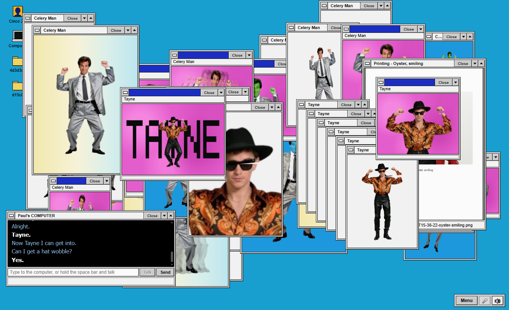

# CINCO ID

**Cinco Identity Generator 2.5.** A talking computer with a Windows 95 screen. You tell it what to load, it opens far
too many windows of dancing figures, answers in a deadpan robot voice, and can do real work, because behind the
screen sits a real AI assistant.

It is an unofficial fan tribute to a certain sketch about a man, his office computer and some dancing sequences, and
is not connected to the people who made that sketch. Say the same lines and you get a similar evening. Say anything
else and it still does something sensible.

The dancers are invented people. Their pictures and dance clips are machine-made (AI-generated).

[](docs/demo.mp4)

**[Watch the demo with sound](docs/demo.mp4)**: the first-start Setup window, the 4d3d3d3 routine, a dancer that was
made from one sentence, and an incoming call. In that video the computer speaks with a voice built into Windows.
There is also [the same demo with the robot voice](docs/demo-robot-voice.mp4).

## What it can do

- **It is a real AI assistant.** The brain is Claude, used through the Claude sign-in you already have on your PC,
  with no extra key. Everything outside the fixed phrases goes to it: questions, sums, "put up three more oysters
  and make them all spin". It answers in one dry sentence and operates the screen itself. It cannot read your files
  or run programs; it only gets the screen and the outside tools you connect. Another chat service with a key works
  too, and it also runs with no brain at all.
- **Dancing sequences as generated video.** The dancers are short see-through video loops of invented people. The
  demo cast ships ready-made. New dancers are made from one spoken or typed sentence, on your own Modal account with
  open video models, or optionally with hosted models through OpenRouter.
- **A voice from 1939.** The computer speaks with [Voder](https://github.com/flujo-app/voder), a small speech
  synthesizer modelled on Homer Dudley's Voder: buzz and hiss shaped by resonant filters. It can use any voice
  installed in Windows instead. It listens with Whisper, running on your own PC.
- **WhatsApp calls.** When someone calls you on WhatsApp, a window shows who it is and the phone rings. You can
  decline. Ask it to accept and it says "I'm afraid I can't do that."
- **Printouts.** "Give me a printout of Oyster smiling" is a real Windows print job, sent to the PDF printer.
- **Far too many windows.** A Win95 desktop with a taskbar, a Start menu and up to 96 windows at once, about twenty
  effects, and any made-up word becomes its own effect and is remembered. In see-through mode the windows and
  dancers sit on top of your real desktop.
- **Open to other AI agents.** FLUJO, Claude Code, Codex or a swarm can operate the screen through a local door.

## Install

Download `CINCO-ID-Setup-2.5.2.exe` from the [releases page](https://github.com/flujo-app/cinco-id/releases) and run
it. It installs for your Windows user only and does not need administrator rights. You get a Start menu entry and a
desktop shortcut; "CINCO ID" in Windows' "Apps" list removes it again (your settings and projects stay in your app
data folder).

The installer is not code-signed, so Windows SmartScreen shows "Windows protected your PC". Click **More info**, then
**Run anyway**. Your browser may also warn about the download; choose to keep it.

To make the installer yourself: `npm ci`, then `npm run dist` (installer in `dist/`) or `npm run pack` (an unpacked
folder in `dist/win-unpacked`, to try without installing).

So far it has only been run on Windows 10.

## Start it from this folder

```powershell
npm install
npm start          # its own window with a Win95 desktop
npm run overlay    # see-through: the windows and dancers sit on top of your real desktop
```

A fresh copy works straight away with no accounts: the desktop, the demo dancers, every fixed phrase, the effects,
the disco music, the test call, printing, and speech in the voice built into Windows.

Keys that work everywhere while it runs:

| Keys | What happens |
|---|---|
| Ctrl+Alt+Space | start or stop talking to it |
| Ctrl+Alt+O | switch between its own window and the see-through mode |
| Ctrl+Alt+Q | quit |

In the window you can also hold the space bar to talk, or type into the "Computer" console.

## Things to say

| Say | It does |
|---|---|
| "Computer, load up Celery Man please." | opens that sequence in a window |
| "Could you kick up the 4d3d3d3?" | starts project 4d3d3d3: the screen fills with copies |
| "Add sequence: Oyster." | adds another dancer |
| "Give me a printout of Oyster smiling." | makes a printout and sends it to the PDF printer |
| "Do we have any new sequences?" | offers a held-back "beta sequence"; say "alright" to see it |
| "Can I get a hat wobble?" | wobbles everything above the hat line |
| "And a Flarhgunnstow?" | any made-up word becomes its own effect, and is remembered |
| "Nude Tayne." | asks you to repeat, then "This is not suitable for work. Are you sure?" |
| "Free" | takes the dancers out of their windows (best in see-through mode) |
| "Rainbow on Oyster", "tumble", "trails", "conga" ... | more effects; "normal" removes them |
| "Close Oyster", "clear the desktop" | tidies up |
| "More disco", "music off", "quiet" | starts or stops the disco music, or stops the voice |
| "What voices do you have?", "use the Zira voice", "talk like the robot" | lists and switches the computer's voice |
| "Test call from my wife", then "answer the call" or "decline" | shows what an incoming call looks like |
| "New project", "kick up the beef" | makes a new, empty project with a hex name |
| "Generate a new sequence of a grandmother in a gold tracksuit doing disco moves" | makes a brand-new dancer in the background |
| "Setup" | opens the Setup window |
| "Link WhatsApp" | opens the Setup window on its WhatsApp page |
| anything else | goes to the brain, if one is connected |

"List everything" shows all projects, sequences, effects and learned words.

## The demo project, and making your own

Everything it can load lives in **projects**. A project is a folder with a hexadecimal name, and each dancer
("sequence") is a folder inside it. See [docs/PROJECTS.md](docs/PROJECTS.md) for the layout.

**`4d3d3d3`** is the pre-built demo project: Celery Man, Oyster, the beta sequence Tayne with his gated variant, and
the bonus dancer Celery Head. "Kick up the 4d3d3d3" starts it.


**`d15c0`** holds one dancer, Grandmother. She was made live, from inside the app, by typing exactly this:

> generate a new sequence of a grandmother in a gold tracksuit doing disco moves

That took 8 minutes 44 seconds and cost about 35 cents. "Kick up the d15c0" shows her.

**Your own:** say "new project" (or kick up a hex name that does not exist yet, such as "kick up the beef") and the
computer starts an empty one. Then describe a dancer in one sentence, as above. Add "called Disco Grandma" to choose
the name. The computer works on it in the background, tells you when it has a new beta sequence, and shows it when
you ask "do we have any new sequences?". Until a dancer has a generated clip, a simple drawn puppet stands in, so
everything also works offline.

## Linking your accounts

None of these is needed for the demo. The Setup window (it opens on the first start, or say "setup") walks you
through all of them.

| For | What you link | How |
|---|---|---|
| The brain | **Claude** | Install [Claude Code](https://claude.com/claude-code) and sign in once, so the `claude` command works. In Setup, choose "The Claude sign-in on this PC". No key is needed. Or choose "A service with a key" for OpenAI, OpenRouter or another chat service. |
| New dancers | **Modal** | Make a [Modal](https://modal.com) account. In Setup, press "Sign in to Modal" (it opens your browser), then "Prepare...", which first shows what it will download and what that costs. For the better dance model you also accept its licence on Hugging Face and store a token in Modal; Setup shows the exact steps. |
| Hosted dance models (optional) | **OpenRouter** | Paste an OpenRouter key into Setup. It is kept encrypted with your Windows sign-in. Then Seedance or MiniMax can be used for the dance step. |
| Incoming calls | **WhatsApp** | In Setup, go to the WhatsApp page (or say "link whatsapp"), press **Link WhatsApp** and scan the QR code with your phone: in WhatsApp, Settings, Linked devices, Link a device. CINCO ID becomes one more linked device on your WhatsApp, and the page switches to "Linked" by itself. Typing your phone number to get a code works too. This needs [Node.js](https://nodejs.org) 22 or newer on the PC. The first time, **Install** on the same page fetches the WhatsApp connector, [mcp-whatsapp-web](https://github.com/mario-andreschak/mcp-whatsapp-web) 1.4.2, which also needs [Git](https://git-scm.com). |

Details for the dancer tools are in [docs/MEDIA.md](docs/MEDIA.md).

**WhatsApp, the manual way.** If another program already runs mcp-whatsapp-web (1.4.2 or newer) for you, CINCO ID can
use that one instead. Run `npm run whatsapp:link` here: it makes a private secret and prints three settings to give to
that connector. To use the Decline button, also list the connector under `mcpServers` in the settings file and set
`events.whatsapp.declineTool` to `"<its name>/reject_call"`. Both ways can be used at the same time.

## What it costs

Running CINCO ID itself costs nothing. The parts that can cost money are your own accounts:

| What | Cost | Time |
|---|---|---|
| The brain on your Claude sign-in | part of your Claude plan's allowance; it uses the small, fast model | 5 to 10 seconds per off-script request |
| One new dancer on Modal (default model, LTX-2.5) | about $0.35 | 6 to 9 minutes |
| One new dancer on Modal with the Wan2.2 model | about $0.80 | longer |
| One new dancer through OpenRouter | about $0.25 (MiniMax) or $0.53 (Seedance) for a 5-second clip at 480p, from the price list, plus a few cents on Modal | not measured |
| Preparing a Modal account once | about $0.25 for all three models (about 240 GB, 40 minutes), or about $0.05 for the default dance model alone (80 GB, 10 minutes, estimated) | once |

**Between dancers nothing keeps running**, so there is no hourly cost. The only standing cost is storage for the
model files on Modal:

- Modal charges $0.09 per GiB per month, and the first 1 TiB per month in a workspace is free
  ([Modal pricing](https://modal.com/pricing), read in November 2026).
- The picture models take 31 GiB, Wan2.2 takes 118 GiB and your own copy of LTX-2.5 takes 75 GiB.
- So storage is free while your whole Modal workspace stays under 1 TiB. Above that, all three together would cost
  about $20 a month.

**Deleting the storage** is safe at any time:

```powershell
modal volume delete beta-sequence-art-weights
modal volume delete beta-sequence-wan-weights
modal volume delete beta-sequence-ltx-weights
```

The drawback is waiting at the next new dancer while the files are fetched again: about 5 minutes and 1 cent for the
picture models (this happens by itself), about 13 minutes and 7 cents for Wan2.2, and about 10 minutes and 5 cents
for LTX-2.5 (run "Prepare..." again; it needs your Hugging Face sign-in). The storage names still carry the
project's first name, Beta Sequence.

## Setup window

The first time it starts, a Setup window opens by itself. It asks what the computer should call you, which voice
it uses (with a "Say something" button to hear it), whether it should listen to you, which brain it uses, and
whether you want to make new dancers on your own Modal account. Press Next to skip anything you do not need.
Open it again any time from the Start menu ("Setup..."), or by saying or typing "setup" or "settings".

- Keys you type into it (for a brain service or for OpenRouter) are kept encrypted with your Windows sign-in, in
  the data folder. They are never shown again, never written into the settings file and never put on a command
  line. Started with `npm run serve` (no desktop window), keys come from environment variables only.
- "Sign in to Modal" runs Modal's own sign-in, which opens your browser. "Prepare..." sets up the dancer tools in
  your Modal account, but only after it has shown what that costs and you said yes.
- Changes to the name, voice and brain apply at once. Listening changes need a restart; Setup offers "Restart now".

## Where your things are kept

| Started as | Settings, memory, printouts, voice cache and projects |
|---|---|
| Installed app | your own app data folder, `%APPDATA%\CINCO ID` (the example projects are copied there on the first start) |
| From this folder (`npm start`, `npm run serve`) | this folder |
| With `CINCO_ID_DATA_DIR` set (or `--data-dir=`) | that folder |

The Start menu on the screen has "Projects folder" and "Printouts folder" to open them.

WhatsApp keeps its own things in a `whatsapp` folder inside the data folder: the sign-in (`whatsapp\session`), the
WhatsApp connector's log (`whatsapp\logs`) and the copy of the connector that Install fetched (`whatsapp\connector`).
This sign-in belongs to CINCO ID alone, so it never gets in the way of another program that runs the same connector.
The private secret for call alerts is kept encrypted with the other keys and is never shown. To remove all of it,
press Unlink in Setup, then delete the `whatsapp` folder.

## Settings

The Setup window writes `harness.config.json` in the data folder. You can also copy `harness.config.example.json`
there and change it by hand. That file stays on your PC and is not put into git.

- **Your name**: `operator`. The computer addresses you by it.
- **Voice out**: the Voder robot voice when it is installed (`pip install git+https://github.com/flujo-app/voder`)
  or when the `voder` project sits next to this folder; otherwise the voice built into Windows. Any voice installed
  in Windows can be chosen: set `"engine": "windows", "voice": "Microsoft Zira Desktop"`, or say "use the Zira
  voice". Microsoft Sam is not part of Windows 10 or 11. If you install it yourself as a Windows voice, it shows up
  in the list like any other.
- **Voice in**: a Python that has `faster-whisper` and a Whisper speech model already on disk (`voice.stt`). The
  model runs on your PC. Nothing is downloaded by this app and no speech leaves the PC.
- **Brain**: `"engine": "claude-cli"` (the Claude sign-in on this PC) or `"engine": "api"` with a `baseUrl`, a
  `model` and a key.
- **Outside tools**: list MCP servers under `mcpServers`. The brain may use them. Any tool that is not marked
  read-only by its server asks you "Shall I?" in a dialog box first, every time.
- **Printing**: every printout is saved as a picture in `printouts/` and sent through the Windows print system to
  the PDF printer, which asks where to save the file. `"printouts": { "print": "dialog" }` shows the normal Windows
  print window instead, `"print": "off"` only saves the picture, and `"printer": "<name>"` picks another printer.

## Incoming WhatsApp calls

When someone calls you on WhatsApp, a window pops up with their saved name, WhatsApp name and number, the phone
rings, and the computer says who is calling. A missed call leaves a note. Decline hangs up for you. The computer
cannot pick up a call; ask it to and it tells you so, and the call keeps ringing. "Test call window" on the WhatsApp
page in Setup shows what a call looks like.

Linking is described under "Linking your accounts" above. While CINCO ID runs, it keeps the WhatsApp connector
running in the background. The console window says when WhatsApp is linked, when the connection has dropped for a
while, and when it is back. If the connector stops, it is started again after a short pause. When CINCO ID quits, the
connector is stopped too. Unlink in Setup asks first, then removes CINCO ID from your linked devices.

**Which one declines a call.** If you use both the Setup link and the manual way, Decline goes through the WhatsApp
connection that reported the call. If that one is not answering right now, the other one is used. The Decline
button is greyed out only while neither of them can do it.

Only the caller's details are shown. Message text from outside is never handed to the brain, so nobody can give the
computer orders by writing to you. Through the Setup link, the brain may look up your contacts (search them, or look
one up), without asking. It cannot send messages. To allow more, list the connector's tool names under
`whatsapp.brainTools` in the settings file; anything beyond the two contact look-ups asks "Shall I?" every time.

## Letting other AI agents use the screen

While it runs, the computer offers a local door for AI agents at `http://127.0.0.1:19773/mcp` (MCP over HTTP).
Anything that can use MCP tools, such as FLUJO, Claude Code, Codex or a swarm, can then load sequences, apply
effects, open note windows, make it speak, or simply send it a sentence as if you had said it.

The door only opens with the access token in `.local/mcp-token` in the data folder (sent as
`Authorization: Bearer <token>`), and only from this PC.

## Safety

- It listens on this PC only. Web pages open in your browser cannot give it orders.
- Outside events must be signed with the shared secret.
- The brain cannot read files or run programs. It only gets the screen tools and the outside tools you list.
- Only one copy runs at a time. Quitting while a dancer is being made asks first.
- The cast is invented people. No real people's faces or likenesses, and nothing explicit: the "nude" variant is a
  lime-green mankini with the hat and boots.

## Tests

```powershell
npm test                                   # fast checks of the logic, the local server and the security rules
npm run test:ui                            # starts the real app silently and plays the whole routine
node test/ui/setup-check.mjs               # goes through the Setup window like a first start (no money, no browser)
node test/ui/sturdy-check.mjs              # busy port, second start, quitting while a dancer is made, a broken settings file
node test/ui/whatsapp-check.mjs            # links WhatsApp with a stand-in connector: Install, QR code, a call, Decline, Unlink
node test/ui/overlay-check.mjs             # checks the see-through mode on the real desktop (Windows)
node test/ui/print-check.mjs               # checks that a printout reaches the Windows print system
node test/ui/clip-check.mjs "Celery Head"  # checks that a generated clip plays see-through
node test/ui/voice-check.mjs               # LOUD on purpose: checks that the computer really speaks
node test/ui/live-generate.mjs --yes-spend # COSTS MONEY: makes a real new dancer from inside the app
node tools/demo/record.mjs --voice zira    # LOUD: records the demo video with the app's own sound (or --voice robot)
```

## Licence

MIT, see [LICENSE](LICENSE). The demo cast's pictures and clips are machine-made; the models used and their licences
are listed in [docs/MEDIA.md](docs/MEDIA.md).
